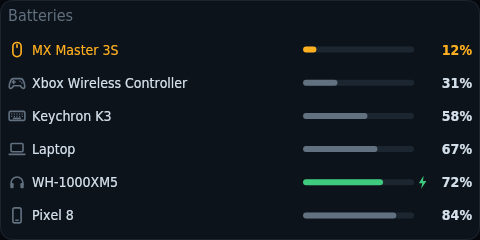
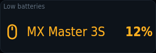

# kiosko-plugin-batteries

The battery of your gadgets on the panel: Bluetooth headphones, mouse, keyboard, game controller, the laptop and the phone, with a warning before one runs out.

A plugin for [Kiosko](https://github.com/kiosko-lcd/kiosko), the widget mosaic for small USB LCD panels.



## Install

In Kiosko, **Plugins → Install from npm** → `kiosko-plugin-batteries`, then restart Kiosko. Or from a terminal:

```sh
npm install --prefix ~/.config/kiosko/plugins kiosko-plugin-batteries
```

(macOS: `~/Library/Application Support/Kiosko/plugins`, Windows: `%APPDATA%\Kiosko\plugins`.)

## Requirements

- Nothing to set up: whatever the system has is read, the rest is skipped.
- Linux: UPower (`upower.service`, in every desktop distribution) read with `busctl` (systemd 240 or newer) or the `upower` command; BlueZ for Bluetooth devices UPower misses; `/sys/class/power_supply` for the rest. For the phone: [KDE Connect](https://kdeconnect.kde.org) paired with it, its Battery plugin on.
- Windows 10 or 11: Windows PowerShell 5.1 (built in). Bluetooth devices show when Windows itself shows their level in Settings → Bluetooth & devices.
- macOS: `ioreg`, `pmset` and `system_profiler`, built in.

## What it does on your machine

- **Runs**: `busctl`, `upower`, `powershell`, `ioreg`, `pmset`, `system_profiler`.
- **Reads**: `/sys/class/power_supply`.
- **Devices**: upower, bluetooth, kdeconnect.

## Widgets

### Batteries — `batteries/list`

Every device with a battery, one per line: the ones running low first, in amber and red, with a bolt on those charging. In a small tile, the lowest one.


Uses: `batteries/devices`.

| Option | Type | Default | |
|---|---|---|---|
| `rows` | number | `0` | Rows. 0 = as many as fit. A number shows that many, in rows of a readable size (fewer when the tile is too small for them); the rest are counted in "+N more". |
| `showBar` | boolean | `true` | Show the level bar |

### Low batteries — `batteries/low`

Only the devices that need charging, or a calm "All charged": for a corner of a page. Takes its tile while one is almost empty.



Uses: `batteries/devices`.

| Option | Type | Default | |
|---|---|---|---|
| `rows` | number | `0` | Rows. 0 = as many as fit. A number shows that many, in rows of a readable size (fewer when the tile is too small for them); the rest are counted in "+N more". |

## Data sources

### Batteries — `batteries/devices`

The battery of your Bluetooth headphones, mouse, keyboard, controllers, laptop and phone, from what the system already knows: UPower, BlueZ and the kernel on Linux, KDE Connect for the phone, PowerShell on Windows, ioreg, pmset and system_profiler on macOS. Nothing to set up. Read every 1 min while a widget uses it. Options are set once in Kiosko → Settings → Data sources.

| Option | Type | Default | |
|---|---|---|---|
| `levelWarn` | number | `15` | Low at. Under this level a device turns amber and goes to the top of the list. |
| `levelAlert` | number | `5` | Almost empty at. Under this level a device turns red and, if full-screen alerts are on, shows one once per discharge. |
| `showAlerts` | boolean | `true` | Full-screen alert when almost empty |
| `devices` | list | `[]` | Devices. Which devices to show, by name or kind: mouse, keyboard, headset, gamepad, phone, laptop; !Xbox* leaves one out. Empty: all. |
| `names` | map | `{}` | Names. Your own names: the name a reader gives (or the device key) → the name to show. "MX Master 3S" → "Mouse". |
| `readers` | list | `[]` | Readers. Which to ask: upower, bluez, sysfs, kdeconnect (Linux), windows, macos; !sysfs leaves one out. Empty: every one this system has. |

## Where the levels come from

Every reader asks something the system already has, read-only, about once a
minute (batteries change slowly). A reader that isn't on your system is
skipped; the same device seen by two readers is shown once (merged by its
Bluetooth address, its kernel name or its serial).

| Reader (`readers`) | System | What it sees | How |
|---|---|---|---|
| `upower` | Linux | The laptop, and most wireless mice, keyboards, headsets and controllers: UPower gathers the kernel's HID batteries, Logitech receivers and BlueZ's levels | [UPower's D-Bus API](https://upower.freedesktop.org/docs/Device.html) (`Percentage`, `BatteryLevel`, `State`, `Type`, `Model`, `IsPresent`) with `busctl --json`; `upower --dump` where busctl is too old |
| `bluez` | Linux | Bluetooth devices that report their battery (the GATT Battery Service, headsets over HFP) | [org.bluez.Battery1](https://github.com/bluez/bluez/blob/master/doc/org.bluez.Battery.rst) and [Device1](https://github.com/bluez/bluez/blob/master/doc/org.bluez.Device.rst), one `GetManagedObjects` call |
| `sysfs` | Linux | The laptop and HID batteries (`hid-…-battery`, `hidpp_battery_*`, `ps-controller-battery-*`…), when UPower isn't running | [/sys/class/power_supply](https://www.kernel.org/doc/Documentation/ABI/testing/sysfs-class-power) |
| `kdeconnect` | Linux | Your phone or tablet, paired with [KDE Connect](https://kdeconnect.kde.org) and its Battery plugin on | `org.kde.kdeconnect.device.battery` (`charge`, `isCharging`) on the session bus |
| `windows` | Windows 10, 11 | Bluetooth devices whose level Windows shows in Settings → Bluetooth & devices; the laptop's battery | Windows PowerShell: the device property `{104EA319-6EE2-4701-BD47-8DDBF425BBE5} 2` with [Get-PnpDeviceProperty](https://learn.microsoft.com/en-us/powershell/module/pnpdevice/get-pnpdeviceproperty), and [Win32_Battery](https://learn.microsoft.com/en-us/windows/win32/cimwin32prov/win32-battery) |
| `macos` | macOS | Apple's Magic Mouse, Keyboard and Trackpad and many Bluetooth HID devices; AirPods and other headphones; the Mac's battery | `ioreg -r -k BatteryPercent -a`, `system_profiler SPBluetoothDataType -json` and `pmset -g batt` |

What none of them can see: devices whose level only their maker's app knows
(some gaming mice and headsets with their own dongle), and on Windows the
phone (KDE Connect for Windows keeps its own bus).

A few devices only say roughly how full they are (UPower's `BatteryLevel`,
the kernel's `capacity_level`): they show *Low*, *OK*, *Full* instead of a
percentage, and *Low* and *Critical* count as under the thresholds.

## Low and almost empty

- Under **Low at** (`levelWarn`, 15 % by default) a device turns amber and
  goes to the top of the list; the *Low batteries* widget shows it.
- Under **Almost empty at** (`levelAlert`, 5 %) it turns red, *Low
  batteries* keeps its tile, and, with **Full-screen alert when almost
  empty** on, Kiosko shows an amber full-screen alert, **once per
  discharge**: once you say *Seen* (or after 15 minutes) it doesn't come
  back until the device has been charged (or rises 5 points over the line)
  and runs down again. A restart doesn't repeat it. A device charging is
  never low. Quiet hours let only critical alerts through, so a mouse never
  wakes you up.

The source can run with no tile for its alerts alone: Settings → Data
sources → Batteries → *Watch for alerts without a widget*. Full-screen
alerts need Kiosko 0.2.7 or later; older ones show the widgets only.

## Names and hiding

- **Devices** (`devices`): `!Xbox*` hides a device, `mouse, keyboard` shows
  only those kinds (`headset`, `mouse`, `keyboard`, `gamepad`, `phone`,
  `laptop`, `tablet`, `pen`, `other`).
- **Names** (`names`): `"MX Master 3S" → "Mouse"`. A device with no name
  (the laptop's battery) is called by its kind.

Nothing leaves your machine: no network, no files written but the plugin's
own record of which device has already been alerted.

## Development

```sh
npm install
npm test          # node:test
npm run check     # TypeScript
npm run build     # dist/index.js, what Kiosko loads
```

To try it in a running Kiosko without publishing: `kiosko plugins link .` and restart Kiosko.

Working on Kiosko and its plugins together: clone them side by side
(`kiosko/` and `kiosko-plugins/kiosko-plugin-batteries/`) and run `npm install` in
`kiosko/`; its workspaces link every plugin found in `../kiosko-plugins`.

## License

MIT
